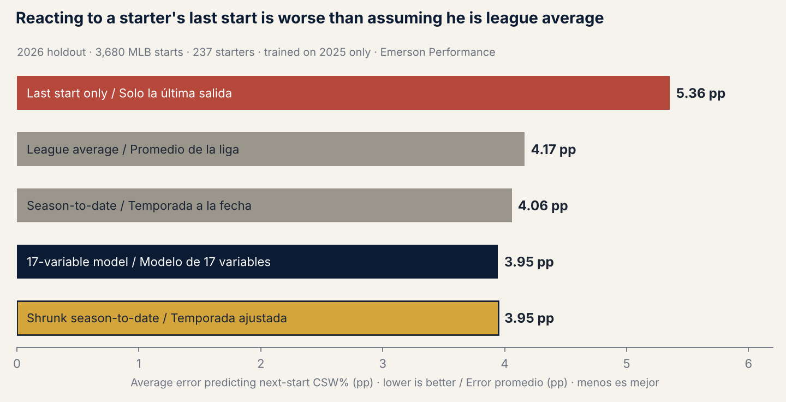

# EP Player Development Hub

**Emerson Jimenez · Emerson Performance**

> From Statcast data to a diagnosis, a next-start expectation and a 12-week offseason plan — for any MLB hitter or pitcher.
> *Del dato de Statcast al diagnóstico, a lo que se puede esperar de la próxima salida y a un plan de offseason de 12 semanas, para cualquier bateador o pitcher de MLB.*

**Live app:** [ep-player-development.streamlit.app](https://ep-player-development.streamlit.app)

---

## v2 headline: reacting to a starter's last start is worse than assuming he is league average
## *Titular v2: reaccionar a la última salida de un abridor es peor que asumir que es promedio de la liga*



**Decision question / Pregunta de decisión:** what should a club expect from a starter's *next* start, using only what is known before it? / *¿Qué debe esperar un equipo de la próxima salida de un abridor, usando solo lo que se sabe antes?*

Trained on 2025, tested once on 2026 (3,680 starts, 237 starters). Target: CSW% (called strikes + whiffs / pitches).
*Entrenado con 2025 y probado una sola vez con 2026 (3,680 salidas, 237 abridores). Variable a predecir: CSW%.*

| Method / Método | Avg. error (pp of CSW) | vs. best rule (95% CI) | Label |
|---|---|---|---|
| Last start only / Solo la última salida | 5.36 | +1.29 to +1.53 pp worse | CONFIRMED |
| League average / Promedio de la liga | 4.17 | +0.15 to +0.30 pp worse | CONFIRMED |
| Season-to-date / Temporada a la fecha | 4.06 | +0.07 to +0.15 pp worse | CONFIRMED |
| 17-variable model (ridge) / Modelo de 17 variables | 3.95 | −0.03 to +0.02 pp (no difference) | NOT CONFIRMED |
| **Shrunk season-to-date / Temporada ajustada** | **3.95** | — | used in the app |

**What it means for a club (CONFIRMED):**
1. **One start is mostly noise.** Projecting the next start from the last one gives 36% more error than the best simple rule — more error than knowing nothing about the pitcher (league average).
2. **The best rule is simple:** season CSW, plus the 2025 season at 25% weight per pitch, pulled toward the league with 500 pitches of league average.
3. **A 17-variable model (recent form, velocity trend, rest, opponent, chase, zone, age…) did not beat that rule** (difference −0.002 pp, 95% CI −0.03 to +0.02 pp; pre-set bar: 2% better). The app therefore uses the simple rule. Of the extra variables, opponent strength carried the most information, but not enough to matter.
4. **Honest uncertainty:** the 80% range is about −6.3 to +6.1 pp around the projection, and in 2026 it contained 78.7% of real starts (target 80%). A start outside the range is a reason to look, not proof of change.

*Qué significa para un equipo (CONFIRMADO):*
1. *Una salida es casi todo ruido. Proyectar la próxima salida con la última da 36% más error que la mejor regla simple, y más error que no saber nada del pitcher (promedio de la liga).*
2. *La mejor regla es simple: CSW de la temporada, más la temporada 2025 con peso de 25% por lanzamiento, acercado a la liga con 500 lanzamientos de promedio de liga.*
3. *Un modelo de 17 variables (forma reciente, tendencia de velocidad, descanso, rival, chase, zona, edad…) no le ganó a esa regla (diferencia −0.002 pp, IC 95% −0.03 a +0.02 pp; umbral fijado antes: 2% mejor). Por eso la app usa la regla simple. De las variables extra, la fuerza del rival fue la que más información aportó, pero no lo suficiente.*
4. *Incertidumbre honesta: el rango 80% va de −6.3 a +6.1 pp alrededor de la proyección, y en 2026 contuvo el 78.7% de las salidas reales (meta: 80%). Una salida fuera del rango es motivo para revisar, no prueba de un cambio.*

**INTERPRETATION / INTERPRETACIÓN:** for development staff, the practical rule is "don't change a starter's program after one start; act on velocity drops and on trends that persist." CSW is game output, not cause — a sustained drop still needs an in-person evaluation (force plates, Trackman, video). / *Para el staff de desarrollo, la regla práctica es "no cambiar el programa de un abridor por una salida; actuar sobre caídas de velocidad y tendencias que se mantienen". El CSW es resultado del juego, no la causa.*

---

## What it does / Qué hace

| Tab | English | Español |
|---|---|---|
| **Profile / Perfil** | Percentile vs. MLB on 11–12 Statcast metrics (pitchers compared only within their role: SP or RP). Strengths and gaps. | Percentil vs. MLB en 11–12 métricas de Statcast (pitchers comparados solo con su rol: abridor o relevista). Fortalezas y áreas débiles. |
| **Trend & alerts / Tendencia y alertas** | 2024–2026 values with a traffic-light status calibrated on real league-wide year-to-year change. | Valores 2024–2026 con un semáforo calibrado con el cambio real de un año a otro en toda la liga. |
| **Offseason plan / Plan de offseason** | Rule-based 12-week plan: each block is triggered by a data finding and includes phases, monitoring metric and literature. | Plan de 12 semanas basado en reglas: cada bloque se activa por un hallazgo en los datos e incluye fases, métrica de monitoreo y literatura. |
| **Next start (v2) / Próxima salida (v2)** | Starters: next-start CSW projection with 80% range, 2026 backtest chart (projection made before each start vs. what happened) and a written report. | Abridores: proyección de CSW para la próxima salida con rango 80%, gráfico del backtest 2026 y un reporte escrito. |
| **Method / Método** | Data, thresholds, limits. | Datos, umbrales, límites. |

## Method v2 / Método v2 (next start)

Pipeline in layers / *Pipeline por capas*:

```
Baseball Savant pitch-level CSV (regular season)        src/pull_statcast.py
  -> BRONZE  data_raw/bronze/YYYY-MM-DD.parquet (immutable, one file per day)
  -> SILVER  DuckDB: clean pitch flags (CSW, whiff, swing, zone, fastball)   src/build_gold.py
  -> GOLD    one row per start + features using ONLY earlier information     data/starts.parquet
  -> MODEL   baselines vs. ridge / gradient boosting, 2025 train -> 2026 test src/next_start_model.py
  -> REPORT  text written from the computed numbers (EN/ES)                  src/report.py
  -> APP     Streamlit reads small cached files; no API key needed          app.py
```

- **Starter** = first pitcher his team used; a start needs 40+ pitches. **Universe:** 3+ earlier starts that season. Starts after a **14+ day absence** (IL return or similar) are excluded as targets (265 starts in 2025–2026). / *Abridor = primer pitcher que usó su equipo; una salida necesita 40+ lanzamientos. Se excluyen las salidas después de 14+ días de ausencia.*
- **No leakage:** every feature comes from earlier starts, the prior season or the opponent's season-to-date numbers *before that date*. Same-game stats are never used to predict the same game. / *Sin fuga de datos: ninguna variable usa información del mismo juego que se predice.*
- **Pre-registered rule:** best baseline and model chosen on 2025 only (model by 5-fold time-series CV); CONFIRMED only if the 2026 error difference has a 95% CI below zero (cluster bootstrap by pitcher, 2,000 reps) **and** the gain is ≥ 2%. / *Regla fijada antes de ver 2026.*
- **Known-answer tests in both directions** (`tests/test_next_start.py`): a simulated world where the opponent matters is CONFIRMED; a world with talent + noise only is NOT CONFIRMED. / *Pruebas con respuesta conocida en las dos direcciones.*
- **Data check:** per-starter whiff rate from the pitch-level build correlates r = 0.99 with Savant's 2026 leaderboard (fastball velo r = 0.96). / *Verificación contra el leaderboard de Savant.*
- **Report text:** generated from the computed numbers with a fixed bilingual template. An optional `--llm` mode lets Claude rewrite the wording; a validator rejects any rewrite containing a number not in the input. The public app uses cached text only. / *El texto se genera de los números ya calculados; el modo opcional con IA no puede agregar números.*

## Method v1 / Método v1 (profile, alerts, plan)

The app follows the EP four-layer template: **Data → Finding → Interpretation → Training application → Monitoring metric.**

1. **Data (CONFIRMED).** Public Baseball Savant leaderboards, 2024–2026. Hitters ≥100 PA; pitchers ≥100 batters faced.
2. **Percentiles (CONFIRMED).** Rank vs. MLB that season; lower-is-better metrics are flipped so 100 = best.
3. **Alerts (CONFIRMED).** Thresholds are not arbitrary: they are the standard deviation of the real 2024→2025 change of every MLB player with both seasons (n ≈ 330–360). Adverse change > 1 SD = 🔴 Alert, > 0.5 SD = 🟡 Watch. Example: 1 SD of bat speed change = 1.05 mph; of fastball velo = 0.96 mph.
4. **Plan (INTERPRETATION).** A training block is triggered when one of its metrics is below the 35th percentile or carries an alert. Content is fixed, written from S&C literature, selected by rules — no LLM-generated text.

## Limits / Límites

- Statcast measures in-game output, not the cause. A velocity or bat-speed drop can come from fatigue, injury, mechanics or age; the plan is a starting point to confirm with an in-person evaluation (force plates, Blast, Trackman).
- Next start: CSW only (not runs or xwOBA, which are noisier per start). The season-end projection assumes a league-average opponent and normal rest, and does not know about offseason changes. The 14-day absence filter is automatic; short injuries inside the window are not detected.
- MLB only; no minor-league or private biomechanics data.
- *Statcast mide el resultado en el juego, no la causa. La proyección de próxima salida es solo CSW, asume un rival promedio y descanso normal, y no conoce cambios de offseason.*

## Run it / Correrlo

```bash
pip install -r requirements.txt              # app only
streamlit run app.py

# rebuild everything (optional: data/ is included)
pip install -r requirements-pipeline.txt
python build_data.py                         # v1: Savant leaderboards
python src/pull_statcast.py 2024 2025 2026   # v2: pitch-level bronze (~50 MB, not committed)
python src/build_gold.py                     # DuckDB silver/gold
python src/next_start_model.py               # validation + projections
python src/report.py                         # cached reports (add --llm for optional rewrite)
python src/make_figure.py                    # README figure
python -m pytest tests/ -q                   # known-answer tests
```

Deploy: push this repo to GitHub → [share.streamlit.io](https://share.streamlit.io) → New app → `app.py`.

## Files

```
app.py                     Streamlit app (EN/ES)
plans.py                   Rule-based training modules (hitters & pitchers)
build_data.py              v1: Savant leaderboards, threshold calibration
src/pull_statcast.py       v2: bronze layer (pitch-level, regular season)
src/build_gold.py          v2: DuckDB silver/gold, one row per start
src/next_start_model.py    v2: baselines vs. model, pre-registered test, projections
src/report.py              v2: bilingual reports from computed numbers (optional LLM + number check)
src/make_figure.py         v2: README figure
tests/test_next_start.py   v2: known-answer tests (signal and null worlds)
data/                      app files (csv/json); next_start_* = v2 outputs
figures/                   README figure
```

## References

Szymanski et al. 2007 (JSCR) · DeRenne & Szymanski 2009 (Strength Cond J) · MacWilliams et al. 1998 (AJSM) · Kageyama et al. 2014 (JSSM) · Petersen et al. 2011 (AJSM) · van der Horst et al. 2015 (AJSM) · Baseball Savant / MLB Statcast definitions.

---
© Emerson Jimenez · Emerson Performance. Data © MLB Advanced Media, used for non-commercial analysis.
